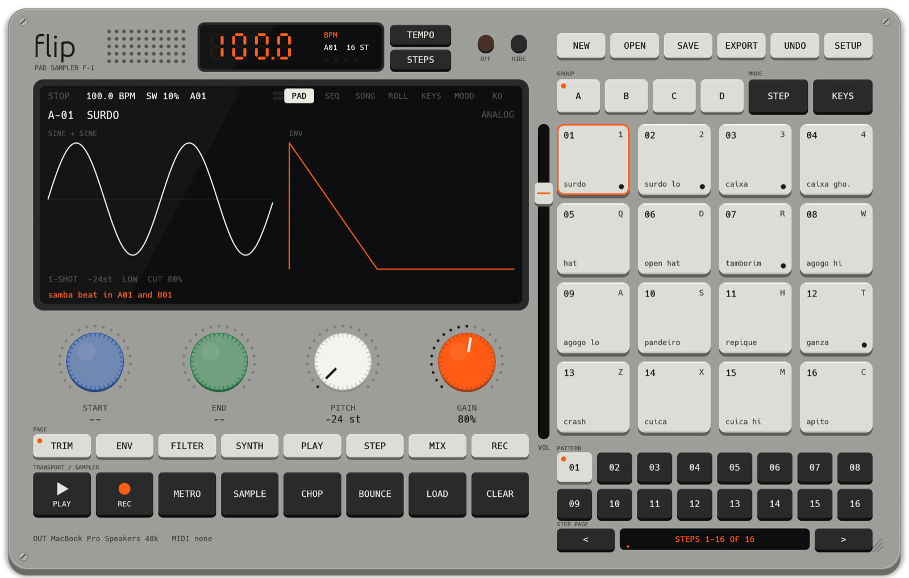

# flip

A pad sampler and synthesizer that runs on your computer. Record sounds, chop them, play them on pads and make loops with a step sequencer.

Read the tutorial at https://rodbove.github.io/flip/.

## Features

- 4 groups (A to D) of 16 pads.
- Each pad plays a sample or a synth engine: ANALOG (two oscillators), FM (four operators, eight algorithms), STRING (plucked or bowed string) or MORPH (a wave that morphs from sine to square, with unison).
- 12 moods load a full set of sounds into the 4 groups: DUSTY, CLUB, TRAP, DREAM, FUNK, CHIP, ORGANIC, DARK, CARIOCA, BOSSA, SAMBA and MPB. Each mood also has a demo beat and bass line. DICE changes one pad to a new sound in the same mood.
- The KO screen imports the EP-133 KO II factory pack (a `.pak` file from teenage engineering). It loads the 5 factory kits and lets you browse the 309 factory sounds by category.
- The KEYS screen shows a keyboard with the keys you play (orange) and the recorded notes that play back (blue), with a trail of recent notes.
- A preset browser with more than 40 factory sounds. Save your own sounds as presets.
- Each pad has a start and end point, pitch, an envelope, a filter, pan and a choke group.
- Play modes: one shot, gate and loop.
- DIRT on each pad: drive, bit crush, sample rate reduction and a dry/wet mix.
- An FX bus with one effect: delay (synced to the tempo), reverb, drive, chorus or compressor. Each group has a send to the bus.
- 8 punch-in effects change the full mix while you hold them: loops of 1/4, 1/8, 1/16 and 1/32, echo, low sweep, high sweep and reverse.
- The group fader has 5 modes: VOL, PITCH, FILT (low pass down, high pass up), SEND and PAN.
- 16 patterns for each group. Each pattern has 1 to 256 steps (up to 16 bars). When a pattern gets longer, its loop repeats into the new bars.
- Each step has a velocity, a note and a chance to play.
- Each pattern also keeps recorded notes with a start, a length and a velocity. Record chords and held notes from a MIDI keyboard, then edit them in the roll.
- A song mode chains patterns.
- Record from a microphone or line input. Recording starts when the sound is louder than the threshold.
- The MONITOR knob plays the audio input through the output. Use it to hear a keyboard or another instrument that connects to your audio interface.
- Resample the master output or one group into a pad.
- Bounce the current pattern into a free pad.
- Chop a sample into slices at each hit.
- Drop audio files (WAV, AIFF, MP3, FLAC, OGG, M4A) on the window to load them.
- Play from the computer keyboard or a MIDI controller.
- Map MIDI controls to the knobs.
- Export a pattern or the song as a WAV file.

## Install

On macOS:

1. Install Rust.
2. Run `./scripts/install.sh`.
3. Open Flip from Applications or Launchpad.
4. Allow microphone access when macOS asks.

The script builds the app and copies `Flip.app` to `/Applications`. If that folder is not writable, it uses `~/Applications`.

## Run from source

Run `cargo run --release`.

To save a screenshot, set `FLIP_SHOT` to a `.tga` path. Set `FLIP_MOOD` to load a mood and its beat first, for example `FLIP_SHOT=shot.tga FLIP_MOOD=samba cargo run --release`.

## Window

Flip has no window frame. It looks like a device on your desktop.

- Drag an empty part of the body to move it.
- Drag the ridges in the bottom-right corner to resize it.
- Push HIDE to minimize it. Push OFF to quit.

## Controls

Read the tutorial at https://rodbove.github.io/flip/ (source: `docs/tutorial.html`).

The keys work by position, so all keyboard layouts use the same keys. The table names the keys by their place on a QWERTY keyboard. After you press a pad key one time, the pad shows the letter of your layout.

| Key | Action |
| --- | --- |
| 1-4, Q-R, A-F, Z-V | Play pads |
| Shift + pad | Select a pad without sound |
| Option + 1-4, Q-R | Hold a punch-in effect |
| Tab | Keys mode: play the selected pad as a piano |
| Z / X | Octave down / up in keys mode |
| Space | Play / stop |
| Enter | Record pad hits into the pattern |
| B | Start or stop a sample recording |
| M | Metronome |
| T or TEMPO | Type a BPM, then press again to set it |
| N or STEPS | Type the number of steps of the pattern (1 to 256), then press again to set it |
| [ / ] | Previous / next pattern |
| Left / Right | Previous / next group |
| Up / Down | Tempo |
| Backspace | Clear the steps of the selected pad (in the roll: its notes) |
| 5 / 6 / 7 / 8 | Screen: pad / steps / song / roll |
| 9 | Record grid: off, 1/32, 1/16, 1/8 |
| 0 | Snap the notes of the selected pad to the grid |
| P | Show the presets |
| Shift + P | Save the selected pad as a preset |
| , / . | Previous / next preset |
| Cmd + Z, S, O, E, N | Undo, save, open, export, new |
| / | Show the key list |

Mouse:

- Drag a knob up or down. Hold Shift for small changes.
- Double-click a knob to reset it.
- Click the label under the group fader to change the fader mode. Double-click the fader to reset it.
- On the FX page, hold a cell on the screen to use a punch-in effect.
- Turn MONITOR (bottom row, left of STEP PAGE) up to hear the audio input. Turn it fully down to stop.
- Right-click a knob, then move a MIDI control to map it.
- Right-click a group to mute it.
- Right-click a pattern to copy the current pattern into it.
- In the step grid, right-click a step to edit its velocity, note and chance.

## MIDI

- Notes 36 to 51 play the 16 pads. Note 36 is the bottom-left pad.
- Other notes play the selected pad at that pitch.
- In keys mode, all notes play the selected pad.
- When you record, notes from keys mode and notes outside 36 to 51 go into the note track of the pattern. Pad notes go into the steps.
- The sustain pedal (CC 64) holds the notes and makes the recorded notes longer.

### Use a keyboard such as the Yamaha PSR-E333

1. Connect the USB TO HOST port of the keyboard to the computer.
2. Open SETUP and select the keyboard as the MIDI port.
3. Turn the keyboard volume down, or set Local Control off, so you hear only Flip.
4. Push Tab for keys mode, so all keys play the selected pad.

## KO II factory pack

Flip does not include the KO II sounds. Import them from your own copy of the factory pack.

1. Download the factory pack (`ep-133-factory-content-*.pak`) from the teenage engineering EP sample tool.
2. Open the KO screen.
3. Click IMPORT FROM DOWNLOADS. If the file is in a different folder, click CHOOSE .PAK.
4. Click a kit to load it: A gets drums, B gets bass and C gets melodic sounds. D stays empty, as on the device.
5. Select a category and click a sound to load it into the selected pad.

The import copies the sounds to `~/Music/Flip/Factory`. Each kit keeps the KO II layout of 12 pads in 3 columns, so the right column of each group stays empty.

## Effects

1. Push FX to show the FX page. The knobs set TYPE, the two effect controls and SEND for the current group.
2. Push FX again to show the DIRT knobs of the selected pad: DRIVE, BITS, RATE and MIX.
3. Hold a cell on the screen, or hold Option and a pad key, to use a punch-in effect. Release it to stop.

The punch-in effects also go into a resample of the master output.

## Presets

Presets save to `~/Music/Flip/presets` as JSON files. A preset keeps the sound of a pad: the engine, the envelope, the filter and the engine settings. It does not keep the sample.

## Projects

A project is a folder. It contains `project.json` and a `samples` folder with WAV files. Projects save to `~/Music/Flip` by default.
